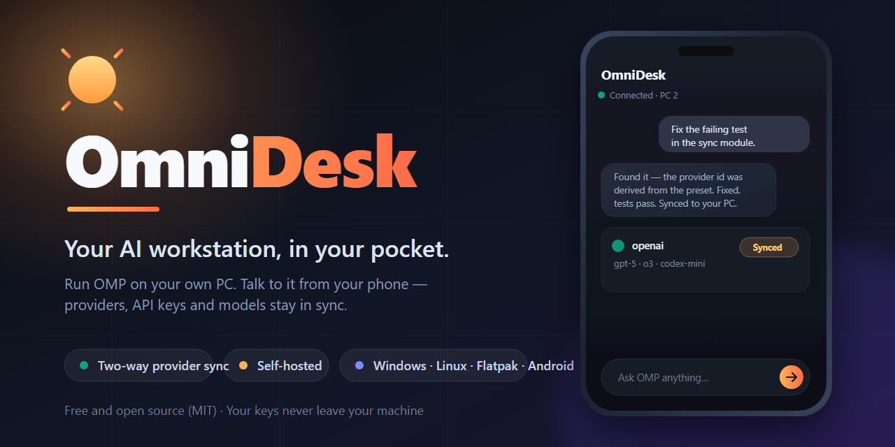
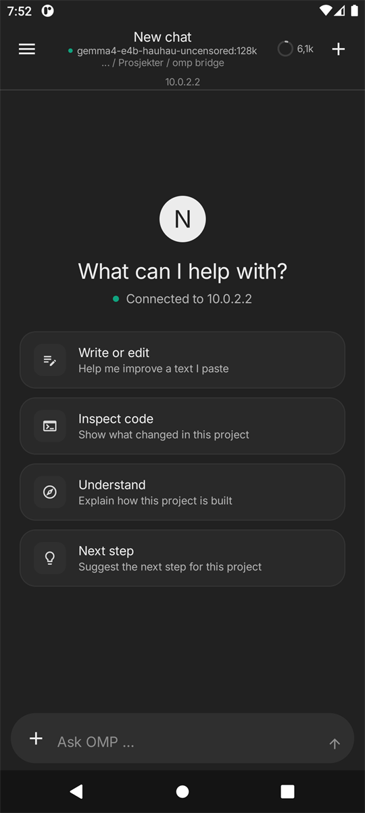
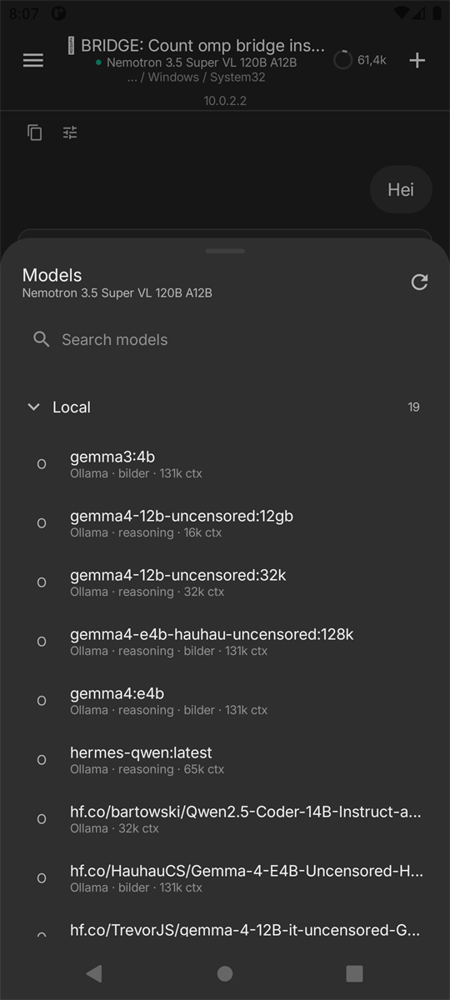
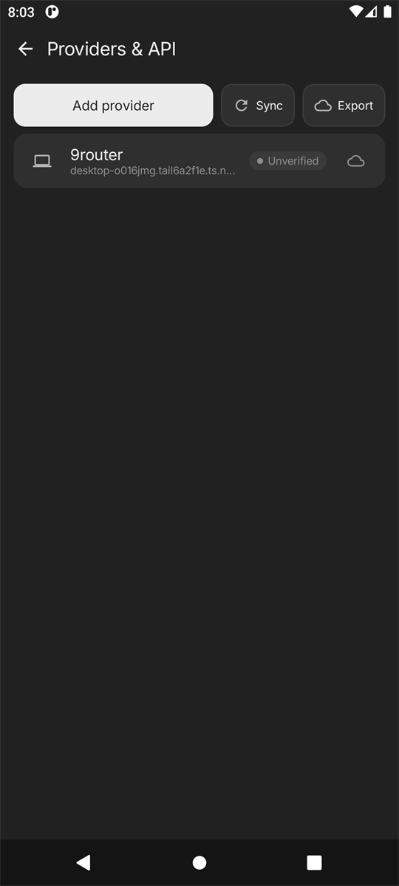
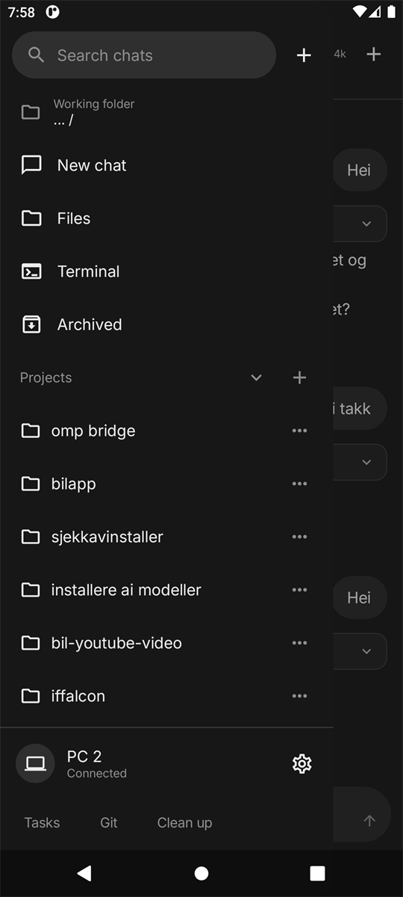
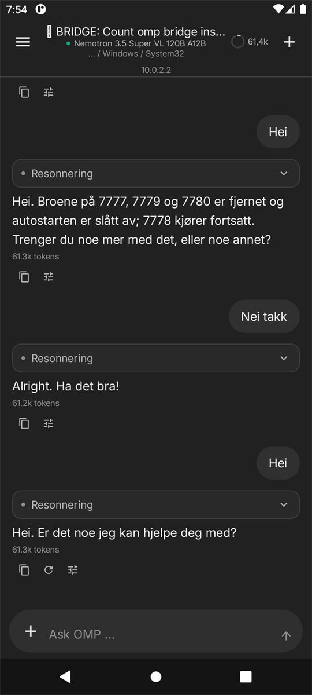
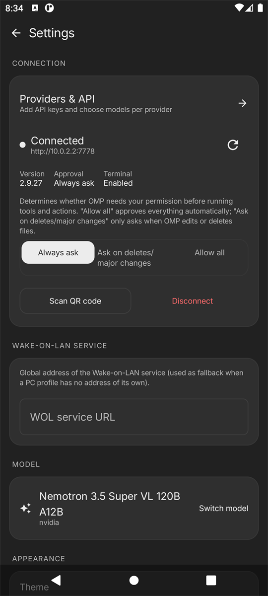

<p align="center">
  
</p>

<p align="center">
  <b>OmniDesk</b> — run your AI agent on your own PC, use it from your phone.<br/>
  Two-way provider sync · Your keys, your hardware, your network.
</p>

<p align="center">
  <a href="https://github.com/megaxenon83-server/ompbridge/releases/latest"></a>
  <a href="LICENSE"></a>
  
  
</p>

---

## What is OmniDesk?

**OmniDesk is a full client for the AI agent that already runs on your computer.**

[OMP (Oh My Pi)](https://github.com/oh-my-pi) is a coding agent that lives in your terminal: it reads your projects, runs commands, edits files and talks to whichever model providers you configure. It is powerful, but it is stuck on the keyboard in front of you.

OmniDesk frees it:

- **OmniDesk Bridge** runs on your PC (Windows, Linux or Flatpak). It speaks OMP's real RPC protocol and exposes it over HTTP + Server-Sent Events on your local network.
- **OmniDesk for Android** is the client. Chat with your agent, approve actions, browse projects, open a terminal, switch models — all from your phone, over your own Wi-Fi or Tailscale.

No account, no cloud relay, no subscription. The model runs on your provider account, the agent runs on your machine, and the traffic never leaves your network.

> **One release, every platform.** The same GitHub release contains the Windows installer, Debian/RHEL packages, a Flatpak bundle, a universal tarball and the signed Android APK.

---

## Highlights

| | |
|---|---|
| **Two-way provider sync** | Add, edit or delete a provider in the phone app and push it to the PC with one tap — or pull the PC's configuration when you connect. The PC stays the source of truth. |
| **Keys stay in the Keystore** | API keys received from the PC are stored in the Android Keystore, never in plain text on disk. |
| **Real agent, not a chatbot** | Tool calls, file edits, terminal access and approval prompts are streamed to your phone. You stay in control of every action. |
| **QR pairing** | Start the bridge, scan the QR code in the app, done. Manual entry and `omp2://` deep links work too. |
| **Your projects, your files** | Browse the PC's project folders, manage files, run a terminal and follow Git state without leaving the app. |
| **Model aware** | Providers, models, favourites and hidden models are synced; visual preferences stay on the device. |
| **Offline-safe** | If the bridge is unreachable, your changes are kept locally and a notification tells you what to retry. |

---

## Screenshots

| Chat with your agent | Model picker | Providers &amp; sync |
|---|---|---|
|  |  |  |

| Projects | A real session | Settings |
|---|---|---|
|  |  |  |

The UI ships in Norwegian and English; the screenshots show the English locale.

---

## How it works

```
┌───────────────────────────── your PC ─────────────────────────────┐
│                                                                    │
│   models.yml ──▶ OmniDesk Bridge (Node.js) ──▶ OMP (`omp --mode rpc`)│
│   providers,      :7777  HTTP + SSE                 real agent    │
│   API keys             ▲                                          │
└────────────────────────┼──────────────────────────────────────────┘
                         │  LAN / Tailscale, bearer token
                         ▼
              ┌─────────────────────────┐
              │  OmniDesk (Android)     │
              │  chat · files · terminal │
              │  Keystore for API keys  │
              └─────────────────────────┘
```

1. The bridge spawns one OMP process per project folder, keeps it warm and normalises its event stream.
2. The app connects over HTTP + SSE with the bridge's pairing token and streams messages, tool calls and approval requests.
3. Provider changes made on either side are reconciled through the bridge's REST API.

More detail: [`docs/ARCHITECTURE.md`](docs/ARCHITECTURE.md) and [`docs/SYNC.md`](docs/SYNC.md).

---

## Provider synchronisation

The bridge owns `~/.omp/agent/models.yml`. The app is a synchronised editor for it.

| | PC wins | App-local |
|---|---|---|
| Provider id, base URL, API key | ✅ | |
| Model list of a provider | ✅ | |
| `enabled` / active state | | ✅ |
| Favourites and hidden models | | ✅ |
| Provider test results | | ✅ |

**Pull** happens automatically when the app connects to a known bridge, and **push** happens when you tap **Sync** in the provider screen after adding, editing or deleting a provider. Offline or failed syncs never discard your work: the change stays on the device and the app tells you to retry.

<details>
<summary>REST surface</summary>

| Method | Path | Purpose |
|---|---|---|
| `GET` | `/api/omp/providers` | List the PC's providers, including API keys |
| `POST` | `/api/omp/providers` | Create or update a provider (`{"provider": {...}}`) |
| `DELETE` | `/api/omp/providers?id=<id>` | Delete a provider |

</details>

---

## Quick start

### 1. Install the bridge on your PC

**Windows** — download `OmniDesk-Bridge-Setup-<version>.exe` and run it. It is a per-user installer: no administrator rights, no Windows service. It installs a Startup-folder entry so the bridge starts with your session, and installs the OMP slash commands `/ompqr` and `/ompserver`.

**Linux**

```bash
# Debian / Ubuntu
sudo dpkg -i omnidesk-bridge_*.deb && omnidesk-bridge-install --local

# Fedora / RHEL
sudo rpm -i omnidesk-bridge-*.rpm && omnidesk-bridge-install --local

# Flatpak
flatpak install com.omnidesk.bridge-*.flatpak

# Universal tarball
tar -xzf omnidesk-bridge-linux-x86_64.tar.gz && ./install.sh
```

The installer creates a `systemd --user` service (`omnidesk-bridge`), enables linger so it starts at boot, and writes the bridge location to `~/.omp/agent/ompchat-commands.json`.

**Requirements:** Node.js 20+ and [OMP](https://github.com/oh-my-pi) on the PC.

### 2. Pair the phone

Run `omp` and then `/ompqr` in the terminal — or open `http://<pc-ip>:7777/apk` on the phone to download the app and scan the QR code. The app can also pair manually by typing the address and token.

### 3. Talk to your agent

That is it. Your projects, models and providers are right there.

Full instructions per platform: [`docs/INSTALL.md`](docs/INSTALL.md).

---

## Downloads

Everything is published on the [releases page](https://github.com/megaxenon83-server/ompbridge/releases). The `stable-beta` prerelease always tracks the newest build.

| Platform | Artifact | Current |
|---|---|---|
| Windows (x64) | `OmniDesk-Bridge-Setup-<version>.exe` | 2.9.28 |
| Debian / Ubuntu | `omnidesk-bridge_<version>_amd64.deb` | 2.9.28 |
| Fedora / RHEL | `omnidesk-bridge-<version>-1.x86_64.rpm` | 2.9.28 |
| Flatpak | `com.omnidesk.bridge-<version>.flatpak` | 2.9.28 |
| Linux (universal) | `omnidesk-bridge-linux-x86_64.tar.gz` | 2.9.28 |
| Android | `omnidesk-android-<version>.apk` | 4.2.6 |

Every artifact ships with a `.sha256` checksum. The Android APK is signed with a release key, so it installs as an update over previous versions.

---

## Repository layout

```
.github/workflows/build-release.yml   GitHub Actions: Android, Linux, Windows, release
2.9.26-bridge/                        Bridge source and installers
  bridge/omp-bridge.mjs               Bridge server (Node.js, ESM, no dependencies)
  commands/                           OMP slash commands (ompqr, ompserver, ompchat-shared)
  tools/                              QR generator, start/stop helpers
  install.sh                          Linux installer (download mode and --local mode)
  packaging/build-linux-packages.sh   Builds tarball + .deb + .rpm
  packaging/build-flatpak.sh          Builds the Flatpak bundle
  flatpak/                            Flatpak manifest, launcher and desktop entry
  build-installer/                    Inno Setup definition + Build-Installer.ps1
android-source/nimayomp-chatgpt-ui-4.2.3/   Android app source (Kotlin, Jetpack Compose)
docs/                                 Architecture, sync, install, build and release notes
```

---

## Building from source

```bash
# Linux packages
bash 2.9.26-bridge/packaging/build-linux-packages.sh 2.9.28 dist

# Flatpak
bash 2.9.26-bridge/packaging/build-flatpak.sh 2.9.28 dist
```

```powershell
# Windows installer (needs Inno Setup 6)
& 2.9.26-bridge\build-installer\Build-Installer.ps1 -Version 2.9.28 -OutputDir dist

# Android (needs the Android SDK and a release keystore in keystore.properties)
$env:ANDROID_HOME='C:\android'
.\gradlew.bat :app:assembleChstgptRelease
```

Pushing a `v*` tag runs GitHub Actions, which builds all platforms and publishes the release. Details, including the required signing secrets: [`docs/BUILDING.md`](docs/BUILDING.md).

---

## Security

- The bridge generates a random pairing token on first start and stores it in `bridge/config.json`, which is never committed.
- Every bridge request except the public APK download requires `Authorization: Bearer <token>`.
- API keys received by the app are stored in the **Android Keystore**, encrypted by the platform.
- The release keystore lives in GitHub Actions secrets, never in the repository.
- The bridge listens on `0.0.0.0` so the phone can reach it — use a trusted network (LAN or Tailscale) and do not expose the port to the internet.

Report vulnerabilities privately: see [`SECURITY.md`](SECURITY.md).

---

## Known limitations

- The bridge rewrites `models.yml` with a minimal YAML writer. Fields it does not manage are preserved, but comments, key order and quoting can change.
- OMP provider entries have no separate display name, so the provider id doubles as the name. The app therefore derives the id of a new provider from the name you type, which keeps both sides on the same entry.
- The bridge and the app can only use one port at a time. Start a second bridge on another port (for example `OMPCHAT_BRIDGE_PORT=7778`).
- The Flatpak bundle runs the bridge fully and installs the OMP commands, but autostart still has to be enabled once from the host (`systemctl --user enable --now omnidesk-bridge`).

---

## Roadmap

- [x] Two-way provider synchronisation
- [x] One release for Windows, Linux, Flatpak and Android
- [x] Signed Android updates
- [ ] Push notifications for completed runs and approval requests
- [ ] Multiple PC profiles with per-profile models and projects
- [ ] Optional end-to-end encrypted relay for use outside the LAN

---

## Contributing

Issues and pull requests are welcome — see [`CONTRIBUTING.md`](CONTRIBUTING.md). Please never commit API keys, pairing tokens or signing material.

## License

[MIT](LICENSE) © 2026 Megaxenon

## Acknowledgements

- **OMP / Oh My Pi** — the agent this project exposes. OmniDesk is a client, not a fork.
- **[Jetpack Compose](https://developer.android.com/jetpack/compose)** — the Android UI.
- **[Node.js](https://nodejs.org)** — the bridge runtime.
