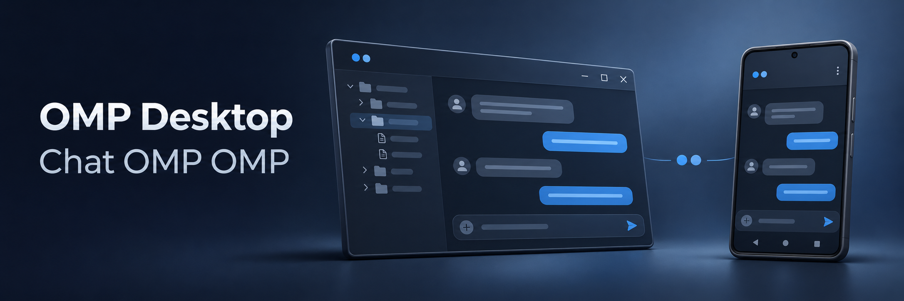

# OMP Desktop and Chat OMP OMP

Use Oh My Pi on Windows and continue the same project conversation on Android. OMP Bridge connects both clients to the projects and model configuration on your PC.

[Project website](https://megaxenon83-server.github.io/ompbridge/) · [Latest release](https://github.com/megaxenon83-server/ompbridge/releases/latest) · [FAQ](docs/FAQ.md)

## Downloads

| Component | What it does |
| --- | --- |
| [OMP Bridge 2.9.36 for Windows](https://github.com/megaxenon83-server/ompbridge/releases/download/omp-desktop-0.8.2/OMP-Bridge-Setup-2.9.36.exe) | Connects Windows and Android. Starts automatically when you sign in to Windows. |
| [OMP Desktop 0.8.2 for Windows x64](https://github.com/megaxenon83-server/ompbridge/releases/download/omp-desktop-0.8.2/OMP-Desktop-0.8.2-win-x64.zip) | Run OMP in project workspaces, preview changes, and pair Android with a one-time QR code. |
| [Chat OMP OMP 0.2.2 for Android](https://github.com/megaxenon83-server/ompbridge/releases/download/omp-desktop-0.8.2/Chat-OMP-OMP-Android-0.2.2.apk) | Continue conversations, review edits, and manage project folders from your phone. |

## Get started

1. Install Node.js 22 or newer and [Oh My Pi](https://github.com/can1357/oh-my-pi) on Windows. Install Git to use Git tracking and review.
2. Run the Bridge installer. New installations use port **7778**. Upgrades preserve the existing port and pairing configuration.
3. Extract OMP Desktop and open **Innstillinger → Tilkobling → Vis QR-kode** (Settings → Connection → Show QR code). Choose the PC address that your phone can reach.
4. Install the APK, open Chat OMP OMP, and scan the code from the same trusted network or VPN.

## Work across both devices

- Follow active conversations, continue the same thread, and share registered project folders. Create a Windows project folder from Android with the graphical folder picker.
- Review changes with per-file added and removed line counts, diffs, and undo. Preview a local web project and share test results with Android.
- Copy or read messages aloud with icon controls. Follow OMP’s live task list during a turn.
- Manage OMP skills, tools, and MCP servers. Enable **Agent Memory**, **Project Status MD**, **Git Overview**, and **Device Control** per shared project.
- Preview skills from the **skills.sh** catalog, then import Markdown from a pinned GitHub revision. Imported skills start disabled.
- Check ADB and confirm whether Windows can reach the phone displaying the status. Device Control can open apps, capture a screen, and send input with approval for each action.

[Installation](docs/INSTALL.md) · [Project panel](docs/PROJECT-PANEL.md) · [FAQ](docs/FAQ.md) · [Security](SECURITY.md) · [Build the installer](docs/BUILDING.md)

Use Bridge on a trusted private network or VPN. Keep the Bridge port off the public internet.
