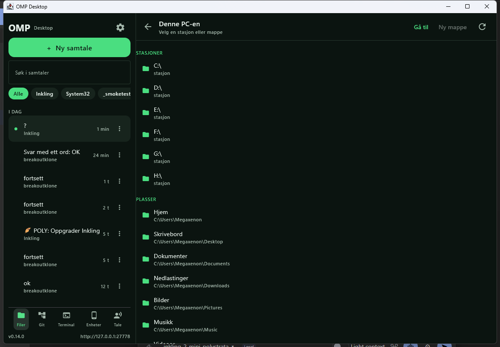
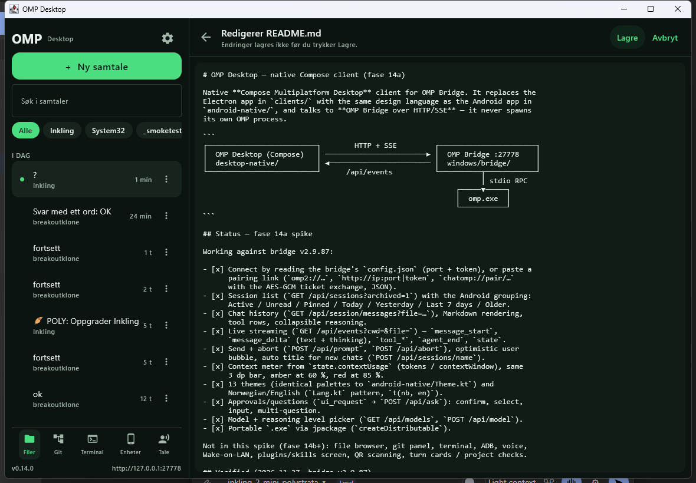
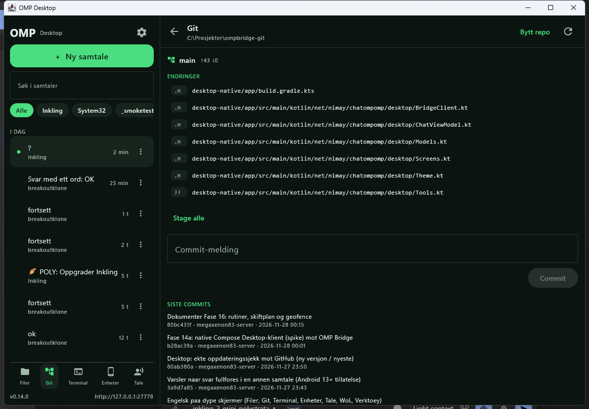
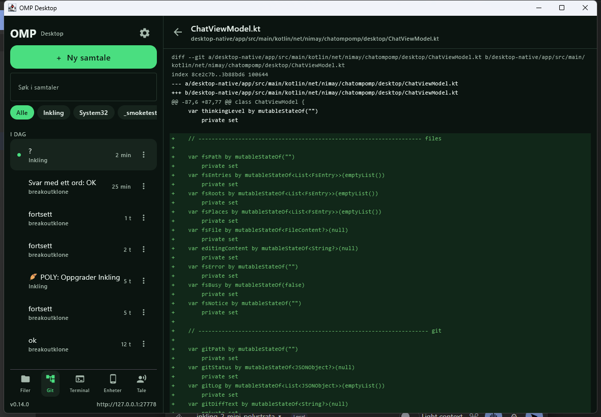
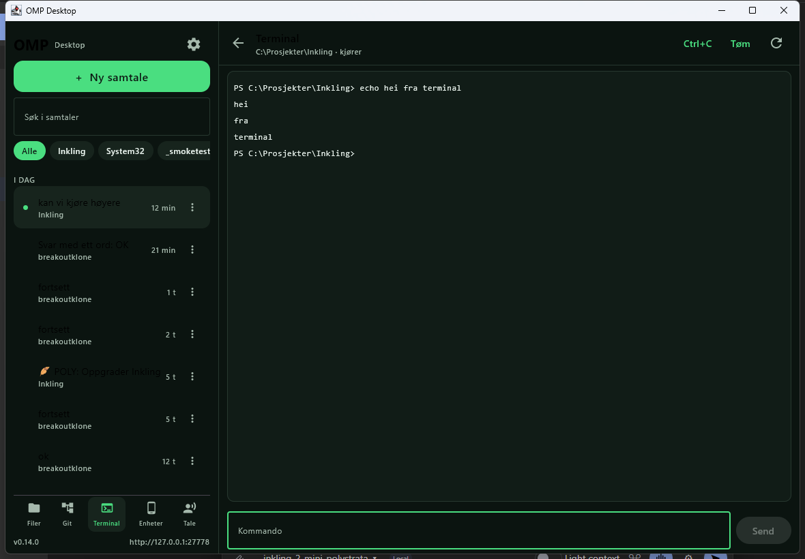
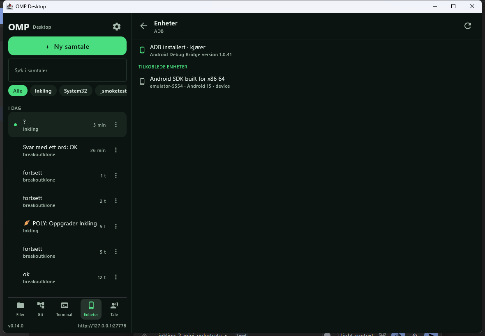
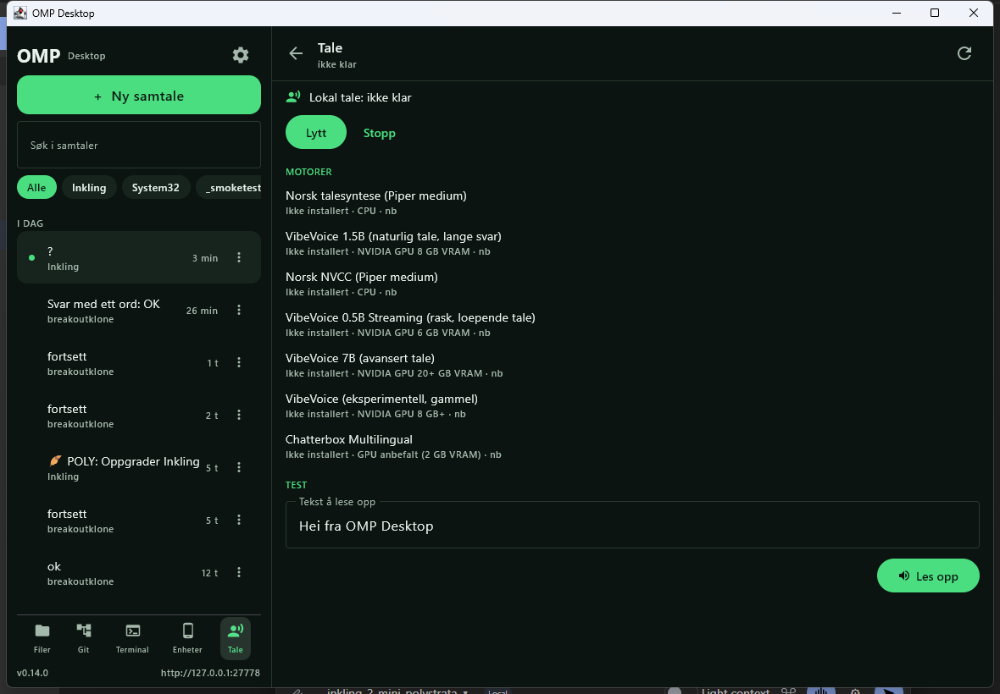
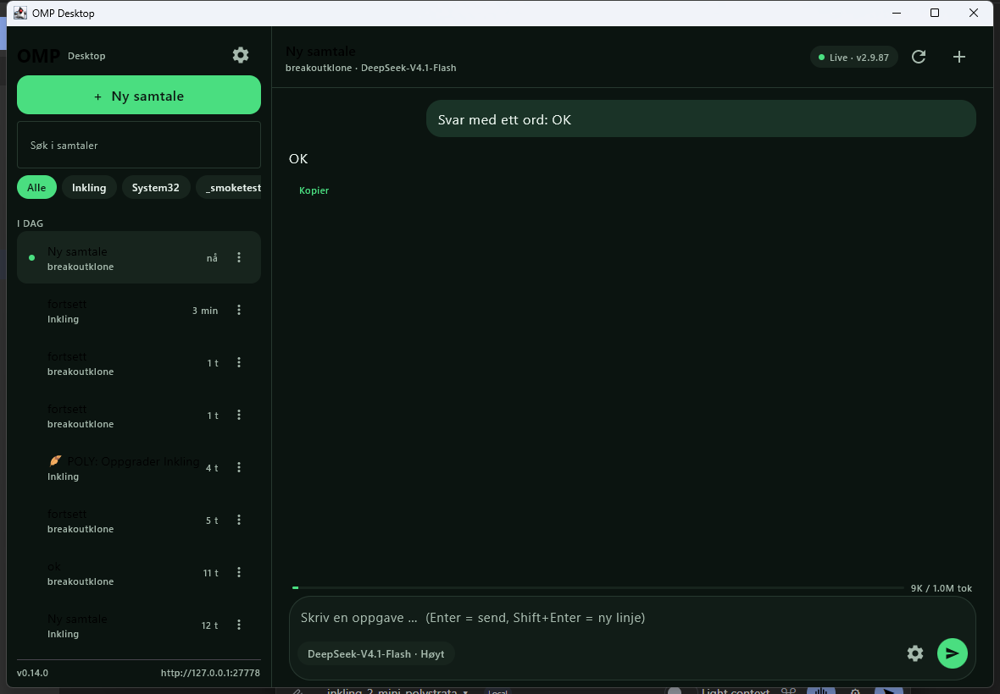
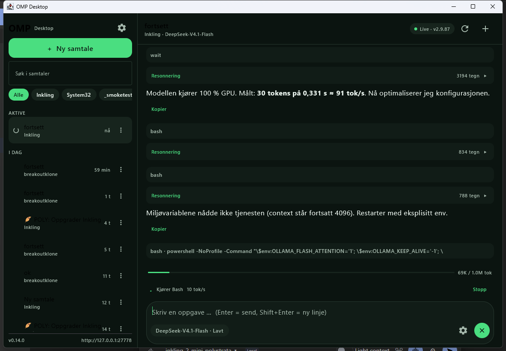
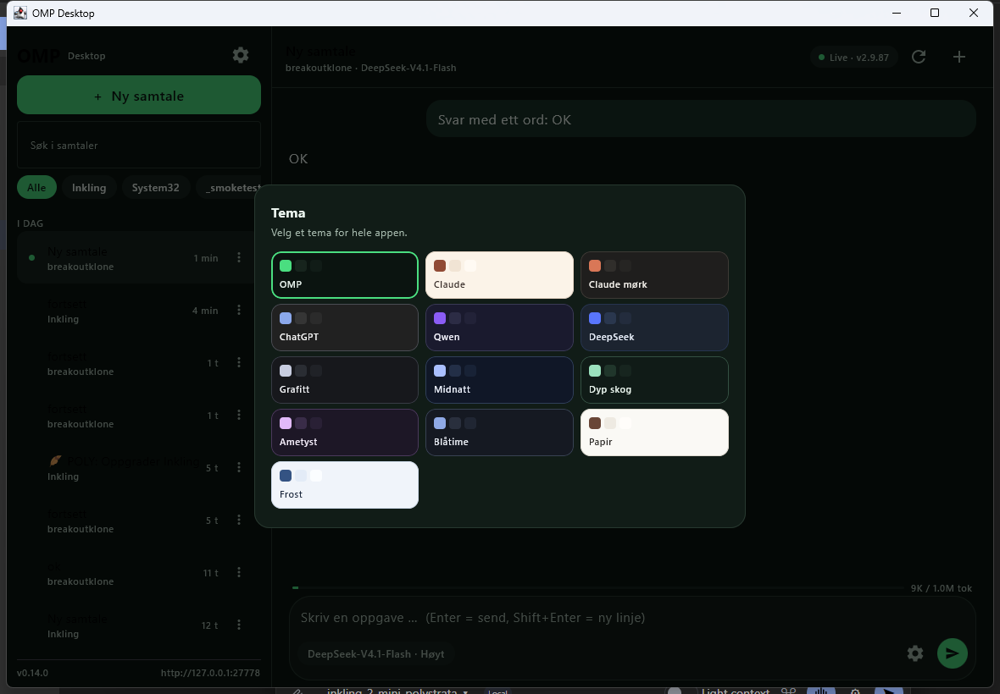

# OMP Desktop — native Compose client (fase 14a + 14b)

Native **Compose Multiplatform Desktop** client for OMP Bridge. It replaces the
Electron app in `clients/` with the same design language as the Android app in
`android-native/`, and talks to **OMP Bridge over HTTP/SSE** — it never spawns
its own OMP process.

```
┌──────────────────────────┐        HTTP + SSE         ┌───────────────────────┐
│  OMP Desktop (Compose)   │ ────────────────────────► │  OMP Bridge :27778    │
│  desktop-native/         │ ◄──────────────────────── │  windows/bridge/      │
└──────────────────────────┘      /api/events          └──────────┬────────────┘
                                                                  │ stdio RPC
                                                            ┌─────▼─────┐
                                                            │  omp.exe  │
                                                            └───────────┘
```

## Status — fase 14b (chat + tools)

Working against bridge v2.9.87:

- [x] Connect by reading the bridge's `config.json` (port + token), or paste a
      pairing link (`omp2://…`, `http://ip:port|token`, `chatomp://pair/…`
      with the AES-GCM ticket exchange, JSON).
- [x] Session list (`GET /api/sessions?archived=1`) with the Android grouping:
      Active / Unread / Pinned / Today / Yesterday / Last 7 days / Older.
- [x] Chat history (`GET /api/session/messages?file=…`), Markdown rendering,
      tool rows, collapsible reasoning.
- [x] Live streaming (`GET /api/events?cwd=&file=`) — `message_start`,
      `message_delta` (text + thinking), `tool_*`, `agent_end`, `state`.
- [x] Send + abort (`POST /api/prompt`, `POST /api/abort`), optimistic user
      bubble, auto title for new chats (`POST /api/sessions/name`).
- [x] Context meter from `state.contextUsage` (tokens / contextWindow), same
      3 dp bar, amber at 60 %, red at 85 %.
- [x] 13 themes (identical palettes to `android-native/Theme.kt`) and
      Norwegian/English (`Lang.kt` pattern, `t(nb, en)`).
- [x] Approvals/questions (`ui_request` → `POST /api/ask`): confirm, select,
      input, multi-question.
- [x] Model + reasoning level picker (`GET /api/models`, `POST /api/model`).
- [x] Portable `.exe` via jpackage (`createDistributable`).

### Fase 14b — full tool parity

The tool row at the bottom of the sidebar opens the same screens as the Android
drawer (Filer, Git, Terminal, Enheter, Tale):

- [x] **Filer** — `GET /api/fs/list` (drives + known places when no path),
      folder navigation with up/`Gå til`, file viewer, in-place editor with
      `POST /api/files/write` (+ `expectedMtime` conflict guard), new folder,
      rename, delete (`/api/fs/mkdir|rename|delete`).
- [x] **Git** — repo picker (bridge projects or any path), branch + ahead/behind
      from `/api/git/status`, changed-file list, colourised unified diff
      (`/api/git/diff`), stage all (`/api/git/stage`), commit
      (`/api/git/commit`), latest commits from `/api/git/log`.
- [x] **Terminal** — real PTY: `POST /api/terminal/create` then a WebSocket to
      `/ws/terminal?id=…` with the bearer header; JSON input frames, live output,
      Ctrl+C, clear, restart, kill on leave.
- [x] **Enheter** — `/api/adb/status` (installed/running/version/devices) and
      `/api/adb/install`.
- [x] **Tale** — `/api/voice/local`, `/api/voice/engines`, start/stop and
      `/api/voice/speak` test line.

Still missing before `clients/` can retire: plugins/skills screen, turn-change
cards, project checks, regenerate, Wake-on-LAN, QR pairing, voice capture
(transcribe), update check, tray/menu integration, and release packaging
signing.

## Verified (2026-11-27/28, bridge v2.9.87)

Run against the live bridge on 127.0.0.1:27778:

| Check | Result |
| --- | --- |
| Auto-connect from `config.json` | `Live · v2.9.87` pill, token never shown |
| Session list + grouping | 40+ chats, Active/Today buckets, pinned/unread dots |
| Open a chat | history + `state.contextUsage` → meter `9K / 1.0M tok` |
| Live SSE turn | streaming text, reasoning card, tool rows, `10 tok/s` |
| New chat | project list from `/api/projects`, new file created |
| Send prompt | typed in composer, Enter → user bubble → answer `OK` |
| 13 themes / NB-EN | theme picker renders all palettes, language chips |
| Files | drives → `Gå til` folder → README.md view → edit → Save (`Lagret …`) |
| Git | `ompbridge-git` repo: `main ↑43`, 7 changed files, diff view, log |
| Terminal | PTY in `C:\Prosjekter\Inkling`, `echo hei fra terminal` round-trip |
| Devices | ADB 1.0.41 running, emulator-5554 · Android 15 listed |
| Voice | local voice not installed, 7 engines listed with hardware notes |













The test session used for the 14a send check was archived afterwards and the
project runtime was switched back to the user's own chat.

## Build and run

Requirements: JDK 17 and Gradle 8.9 (the machine paths are pinned in
`build.ps1`, change them there if yours differ).

```powershell
cd desktop-native
.\build.ps1 run                    # start from source
.\build.ps1 :app:createDistributable   # portable app-image with OMP Desktop.exe
.\build.ps1 :app:packageExe        # jpackage .exe installer (downloads WiX)
.\build.ps1 :app:packageMsi        # jpackage .msi installer
```

Built artifacts (fase 14a + 14b):

- portable: `app/build/compose/binaries/main/app/OMP Desktop/OMP Desktop.exe` (118 MB folder)
- installer: `app/build/compose/binaries/main/exe/OMP Desktop-1.14.0.exe` (58 MB)

Without the helper script:

```powershell
$env:JAVA_HOME = "C:\Prosjekter\Inkling\tools\jdk-17.0.20.101-hotspot"
C:\Prosjekter\Inkling\tools\gradle-8.9\bin\gradle.bat -p . :app:run
```

The packaged app-image ends up in
`app/build/compose/binaries/main/app/OMP Desktop/OMP Desktop.exe`.

## Configuration

The app looks for a bridge token in this order:

1. saved pairing in `%LOCALAPPDATA%\OMPDesktop\settings.json`,
2. `%LOCALAPPDATA%\Nimay\OMPBridge\bridge\config.json` (the normal install),
3. `%APPDATA%\Nimay\OMPBridge\bridge\config.json`,
4. `%ProgramFiles%\Nimay\OMPBridge\bridge\config.json`,
5. `windows\bridge\config.json` relative to the working directory,
6. a pairing link pasted into the connect screen.

`host: 0.0.0.0` in the bridge config is treated as `127.0.0.1`.

## Source map

| File | Mirrors | Purpose |
| --- | --- | --- |
| `Main.kt` | `MainActivity.kt` | Window, theme + language providers |
| `Theme.kt` | `Theme.kt` | 13 palettes, identical hex values |
| `Lang.kt` | `Lang.kt` | `AppLang`, `LocalLang`, `t(nb, en)` |
| `Models.kt` | `Models.kt` | `SessionInfo`, `Entry`, `StreamState`, `ModelInfo` |
| `BridgeClient.kt` | `BridgeClient.kt` | OkHttp JSON + okhttp-sse stream, bearer auth |
| `ChatViewModel.kt` | `AppViewModel.kt` | State holder: sessions, streaming, context, approvals |
| `Markdown.kt` | `Markdown.kt` | Markdown → AnnotatedString, unchanged |
| `Screens.kt` | `Screens.kt` | Connect, sidebar, chat, composer |
| `Tools.kt` | `Screens2.kt` | Files, Git, Terminal, Devices, Voice screens |
| `Dialogs.kt` | `Screens.kt` sheets | Approval, theme, model, new chat, settings |
| `Prefs.kt` | `BridgeClient` prefs | Desktop settings as one JSON file |
| `BridgeConfig.kt` | `pair()` | config.json discovery + pairing links |

Desktop differences, on purpose:

- the session drawer is a permanent left rail instead of a hamburger drawer,
- bottom sheets are dialogs,
- Enter sends, Shift+Enter makes a new line,
- window size and drafts are remembered between runs.

## Verification

Bridge endpoints exercised by the spike:

```
GET  /api/health              version + runtimes
GET  /api/sessions            ?archived=1
GET  /api/session/messages    ?file=
GET  /api/state               ?cwd=   (contextUsage, model, thinkingLevel)
GET  /api/events              SSE, ?cwd=&file=
POST /api/prompt              {cwd, file, text, thinking}
POST /api/abort               {cwd, file}
POST /api/ask                 {cwd, id, confirmed|value|answers|cancelled}
GET  /api/models              ?cwd=
POST /api/model               {cwd, file, provider, modelId}
POST /api/sessions/new        {cwd}
POST /api/sessions/name       {file, cwd, name}
POST /api/sessions/archive    {file, archived}
GET  /api/projects
GET  /api/fs/list             ?path=  (drives/places when empty)
GET  /api/files/read          ?path=
POST /api/files/write         {path, content, expectedMtime}
POST /api/fs/mkdir            {path}
POST /api/fs/rename           {from, to}
POST /api/fs/delete           {path}
GET  /api/git/status          ?path=
GET  /api/git/diff            ?path=&file=
GET  /api/git/log             ?path=
POST /api/git/stage           {cwd, files}
POST /api/git/commit          {cwd, message}
POST /api/terminal/create     {cwd, cols, rows}
WS   /ws/terminal             ?id=   (Authorization header, JSON input frames)
POST /api/terminal/kill       {id}
GET  /api/adb/status
POST /api/adb/install
GET  /api/voice/local
GET  /api/voice/engines
POST /api/voice/start|stop|speak
```

The bridge in `windows/bridge/` is **not** modified by this phase, and neither is
`android-native/`.
